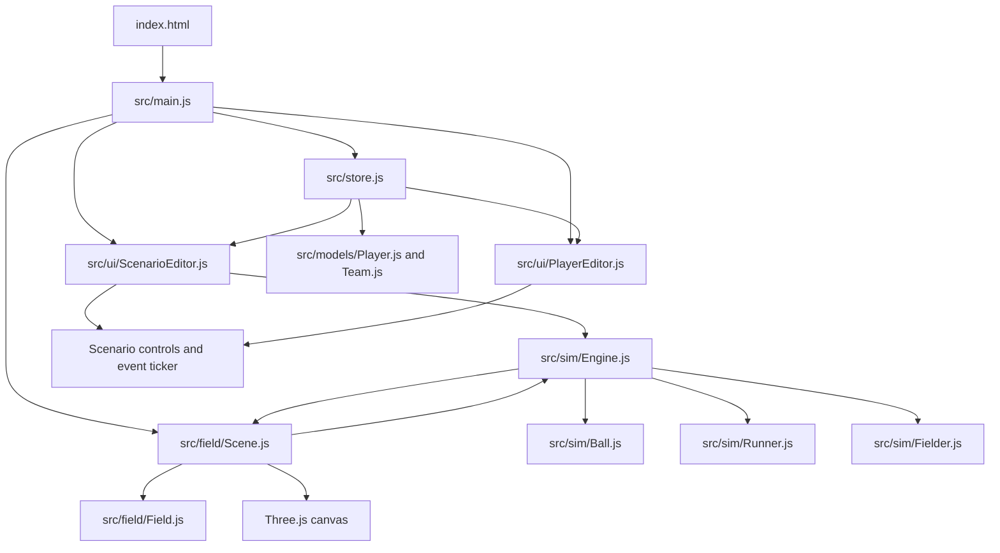

# Slow-Pitch Simulator Architecture

This document describes the current implementation of the Slow-Pitch Play Simulator. The application is a browser-only Vite app using vanilla ES modules and Three.js. There is no server-side runtime.

## System Overview



The main runtime relationships are:

- `main.js` composes the store, scene, and UI components.
- `store.js` owns team and player data and persists it to `localStorage`.
- `Scene.js` owns the Three.js scene, camera, renderer, and animation loop.
- `Engine.js` owns one play and coordinates the ball, runners, fielders, and play rules.
- `ScenarioEditor.js` translates DOM input into scenario definitions and displays play events.
- `PlayerEditor.js` edits the shared roster through store mutations.

## Startup and Composition

1. `index.html` provides `#app` and loads `src/main.js` as a module.
2. `main.js` creates the store. The store loads saved teams or creates the default home and away teams.
3. `main.js` constructs `FieldScene` with the store reference. The scene builds static field geometry and creates a `SimulationEngine`.
4. The scene starts its `requestAnimationFrame` loop.
5. `ScenarioEditor` and `PlayerEditor` mount their DOM controls.
6. The scenario editor reads the current teams, populates its selectors, and loads an initial scenario so players are visible before a play starts.

The scene is also exposed as `window.appScene` so the camera control in the scenario UI can call `reset3DView()`.

## Module Responsibilities

### Application and data

- `src/main.js`: application composition and UI mounting.
- `src/store.js`: observable team store, persistence, malformed-storage fallback, and update notifications.
- `src/models/Player.js`: player factory, default attributes, ID generation, and attribute clamping.
- `src/models/Team.js`: team factories and roster helpers such as batting order and unused positions.
- `src/config/player-configs.js`: default roster configuration.
- `src/constants.js`: field measurements, coordinate values, base order, and defensive position groups.

### Field and rendering

- `src/field/Field.js`: static field meshes and conversion from field coordinates to Three.js world coordinates.
- `src/field/Scene.js`: Three.js scene graph, orthographic camera, lighting, OrbitControls, orientation helper, resize handling, and the frame loop.

The field uses feet as its logical unit. Field coordinates use home plate as `(0, 0)`, with positive `y` toward center field and positive `x` toward first base. `toWorld(x, y, height)` maps this to Three.js coordinates as `(x, height, -y)`.

### Simulation

- `src/sim/Engine.js`: play state machine, entity creation, defensive AI, ball possession, throws, catches, tags, force plays, scoring, outs, and play termination.
- `src/sim/Ball.js`: hit and throw trajectories, gravity, ground friction, possession, landing, and dead-ball state.
- `src/sim/Runner.js`: base-path movement, safe-base tracking, scoring, and out state.
- `src/sim/Fielder.js`: defensive player position, movement, ball-carrying state, and caller state.
- `src/sim/physics.js`: reserved conversion helper (`attributeToRealWorld`); most current physics conversion is implemented directly in the simulation classes.

### User interface

- `src/ui/ScenarioEditor.js`: hit type, hit location, runner occupancy, batter selection, play controls, scoreboard, event ticker, and camera reset control.
- `src/ui/PlayerEditor.js`: team/player selection, player identity fields, and seven editable attributes.
- `src/style.css`: layout and visual styling for the DOM controls.

## State Model

### Persisted store state

The store contains an array of teams. Each team contains players with identity, fielding position, batting order, jersey number, and attributes:

```js
{
  id,
  name,
  players: [{
    id,
    name,
    position,
    battingOrder,
    number,
    attributes: {
      speed,
      throwingTechnique,
      throwAccuracy,
      armStrength,
      catchAccuracy,
      battingContact,
      battingPower
    }
  }]
}
```

Attribute values are clamped to integers from 1 through 100. New players default to 55 for each attribute. Store updates persist under `slowpitch-sim:teams:v1` and notify subscribers. Loading merges missing attributes with current defaults, while malformed or absent storage falls back to valid defaults.

`PlayerEditor` changes are immediate: it calls `store.update(...)`, which persists and notifies listeners. Scenario changes do not mutate the store; they rebuild the active simulation state.

### Engine state

An engine has:

- `state`: `idle`, `playing`, or `paused`.
- `scenario`: current hit type, target, runner configuration, paths, and fielding positions.
- `ball`: one `Ball` instance.
- `runners`: active `Runner` instances, including the batter.
- `fielders`: active `Fielder` instances.
- `score` and `outs`: play-local counters.
- pending throw/tag data used while resolving defensive actions.

`loadScenario()` clears dynamic meshes and recreates the play entities. It resets ball, score, outs, and engine state. `startPlay()` begins motion. `pause()` stops simulation updates without discarding the play; `resume()` continues it. `endPlay()` returns the engine to `idle` and settles/clears the active play.

### Entity states

The ball uses these modes:

- `idle`: no active ball motion.
- `hit`: moving from a batted ball trajectory.
- `throw`: traveling between a fielder and target.
- `loose`: on the field and recoverable.
- `held`: owned by exactly one fielder.
- `dead`: play-ending ball state.

A runner tracks its current base, last safe position, passed bases, queued path, `isOut`, `hasScored`, and movement status. A fielder tracks position, target, movement speed, `isCaller`, `hasBall`, and whether it remains active.

## Events and Command Flow

There is no global event bus. Engine events use an optional `engine.onEvent(event)` callback, and the scenario editor consumes those events to update the event ticker and scoreboard. Store events use a separate subscription mechanism.

### User-originated commands

| Source | Action | Effect |
| --- | --- | --- |
| Scenario selectors | `change` | Rebuilds the configured scenario and repositions entities. |
| Start button | click | Loads the current scenario, then calls `startPlay()`. |
| Pause button | click | Changes engine state to `paused`. |
| Resume button | click | Changes engine state to `playing`. |
| Reset button | click | Loads the current scenario without starting it. |
| End Play button | click | Calls `endPlay()`, settles runners, clears the ball, and returns to `idle`. |
| Camera control | click | Calls `window.appScene.reset3DView()`. |
| Player editor fields | `input`/`change` | Mutates the roster through `store.update()`. |

### Engine event types

Event payloads are plain objects with a `type` property. The currently used event vocabulary is:

| Event | Meaning | Typical payload |
| --- | --- | --- |
| `play_started` | A hit has been launched and runners have started. | `hitType`, `target` |
| `fielder_call` | The primary pursuing fielder changed. | `fielder`, `target` |
| `ball_collected` | A fielder secured the ball. | `fielder` |
| `ball_thrown` | A carrier released a throw. | `fielder`, `target`, `playType` |
| `runner_cut_off` | A runner was stopped at a defensive base or cutoff. | `runner`, `baseName` |
| `runner_held` | A runner was held at a safe base. | `runner`, `baseName` |
| `tag_attempt` | A fielder attempted to tag a runner. | `fielder`, `runner` |
| `run_scored` | A runner reached home. | `score` |
| `runner_out` | A runner was retired. | `outs` |
| `play_stopped` | The play ended manually or automatically. | `reason` |

The ticker keeps only the five most recent messages. It is presentation state, not an event history or replay log.

### Store notifications

`store.subscribe(listener)` registers a listener called after `setTeams()` or `update()`. `PlayerEditor` uses this to refresh its selectors and values after roster changes. The store is the source of truth for teams; the engine receives a snapshot/reference when scenarios are built and does not replace the store during play.

## Frame and Rendering Flow

`FieldScene` runs one animation loop for both rendering and simulation:

```text
requestAnimationFrame
  -> calculate dt and cap it at 0.1 seconds
  -> run registered per-frame callbacks
  -> engine.update(dt)
       -> ball.update(dt)
       -> each runner.update(dt)
       -> updateFielderAI()
       -> each fielder.update(dt)
       -> resolve catches, throws, tags, and force plays
  -> OrbitControls.update()
  -> render the Three.js scene
  -> render the orientation helper
```

The field is built once. Scenario loading replaces dynamic player meshes in `tokensGroup`. Runner and fielder field positions are converted with `toWorld`; the ball also uses its height component for world `y`. The ball is visible while airborne or loose and hidden when inactive or held. Player labels are sprites positioned above player meshes.

The orthographic camera is fitted to the configured field bounds and recalculated on resize. OrbitControls supports rotation, pan, and zoom; its polar-angle limit prevents viewing from below the field. The orientation helper and reset control provide canonical camera views.

## Behavioural Rules

### Scenario setup

A scenario selects one of five hit types (`grounder`, `line_drive`, `blooper`, `flyball`, `pop_up`), one of the predefined hit zones, a batter, and one of the eight first/second/third occupancy combinations. The engine creates fielders from the defensive team and runners from the selected occupancy plus the batter.

Starting always reloads the selected scenario first, so stale entities and play counters do not carry over. Reset performs the same setup but leaves the engine idle.

### Hit and ball physics

`Ball.hit()` derives launch direction and speed from hit type, target, batting contact, and batting power. Contact controls target variance; power increases horizontal speed for grounders and line drives. Airborne balls are integrated under gravity. On reaching ground level, a ball is marked landed and its vertical velocity is stopped. Ground friction then decelerates it until it stops.

A caught airborne ball can retire the batter. A grounder, or any ball already marked landed, cannot later be treated as a caught fly. When a fielder throws, possession is released immediately and the ball follows a finite ballistic throw path. A failed or missed throw becomes loose rather than being silently received by a base.

### Defensive AI

The engine continually reevaluates the ball's current/projected position. It selects at most one available caller, normally the fielder with the shortest estimated arrival time based on distance and movement speed. Other fielders cover responsible bases, cutoff lanes, or backup zones.

Airborne pursuits follow the projected landing point until the ball lands or is caught. Loose-ball pursuits follow the live ball position. Position responsibilities are grouped between infielders, catchers/pitchers, and outfielders, with base-specific coverage used when runners advance.

### Running, scoring, and outs

Runners follow queued base coordinates in order at a speed derived from their own `speed` attribute. Each runner records safe-base state so a cut-off runner can return toward the last safe position. Reaching home marks the runner scored, increments the score once, and removes the runner from active base running.

Valid defensive outs are:

1. A catch of an airborne batted ball.
2. A force out when a fielder carrying the ball reaches the forced base first.
3. A tag when a ball-carrying fielder reaches an active runner within tag range.

Catch and stop attempts incorporate the fielder's `catchAccuracy` attribute and relative ball speed; imperfect fielding can result in bobbles/loose balls. Force plays cleanly retire runners arriving late, while runners beating the throw remain safe on base. Second base coverage is dynamically split between SS and 2B according to hit direction to avoid fielder collisions. When the defense secures the ball and runners are settled at safe bases, the play transitions automatically to idle.

Bases do not catch balls or record outs independently. A runner who is out stops moving and cannot later score. When all runners in the active play are out, the engine stops the play.

### Manual direction (paused play)

`DirectionController` (`src/ui/DirectionController.js`) is created by `FieldScene`. While the engine is `paused`, a click (not an orbit drag) raycasts against fielder, runner and ball meshes and the ground plane.

- Click a fielder to select it (yellow highlight). Then click the ball (`engine.directFielderToBall`) or a field spot (`engine.directFielder`).
- If the selected fielder holds the ball, click another fielder to throw (`engine.directThrow`). The throw uses the normal throw speed/range/accuracy rules, so it can miss.
- Click a runner, then a base within 10 ft of the click (`engine.directRunner`). `validRunnerBases` allows only later bases in order, plus the last safe base if the runner is between bases.

Manually directed fielders get `manualTarget`: the AI no longer moves or auto-throws for them, they may field the ball without being the AI caller, and while holding the ball they tag runners in reach or force at a base (`updateManualPlays`). Manual runners skip the AI hold/advance check in `handleBaseReached`. Manual state resets when a scenario loads. Ticker events: `manual_move`, `manual_chase`, `manual_throw`, `manual_run`.

## Coordinate and Timing Conventions

- Distances and positions in simulation code are feet.
- Velocities and movement speeds are feet per second.
- Gravity is approximately `32.2 ft/s^2`.
- Ground friction is approximately `35 ft/s^2`.
- Frame delta is capped at `0.1` seconds to limit large simulation jumps after a stalled frame.
- The field-to-world mapping flips field `y` into Three.js `z`; world `y` is vertical height.

## Current Limitations

The architecture has extension points for several behaviours that are not complete or are intentionally simplified:

- Manual fielder movement is not wired into the UI; `manualTarget` is reserved for that override.
- Runner return-to-base, tag resolution, and throw cutoff/interception paths are only partially implemented.
- There is no wind, spin, bounce model, fatigue, acceleration, running animation, or perspective camera.
- AI decisions are recalculated every frame and do not use a commitment window, so target changes can be abrupt.
- Scenario locations are hard-coded; there are no custom trajectories, replay controls, play history, or aggregate statistics.
- Collision checks use straightforward distance tests rather than spatial indexing.
- The event ticker is bounded to five entries and is not a durable event log.

The functional requirements and externally observable acceptance rules are maintained separately in [functional-spec.md](functional-spec.md). When implementation and specification differ, this architecture document describes the current code path and the functional specification describes the intended contract.
